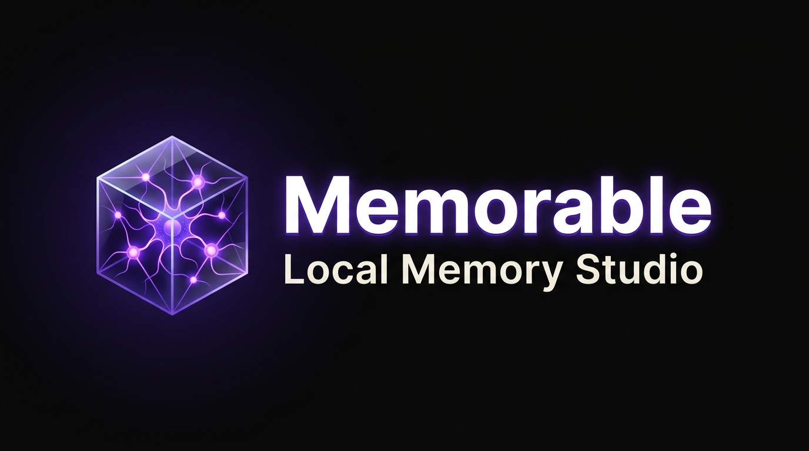
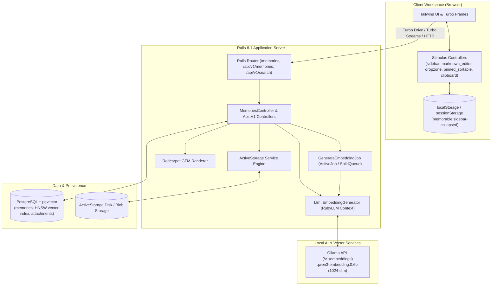

<p align="center">
  
</p>

# Memorable

<p align="center">
  <strong>A local-first memory management studio and developer workbench for persistent context and AI memory.</strong>
</p>

<p align="center">
  <a href="https://ruby-lang.org"></a>
  <a href="https://rubyonrails.org"></a>
  <a href="https://hotwired.dev"></a>
  <a href="https://tailwindcss.com"></a>
  <a href="https://www.postgresql.org"></a>
  <a href="https://github.com/pgvector/pgvector"></a>
  
  <a href="https://github.com/leouofa/memorable"></a>
</p>

---

## Overview

Software engineers and AI practitioners frequently manage long-lived user contexts, memories, architecture decisions, and persistent knowledge across disjointed notes and temporary files.

**Memorable** is a dedicated, distraction-free desktop memory workbench designed to run locally. It provides a flat, uncluttered workspace for capturing, curating, previewing, and pinning critical instructions and knowledge—with instant one-click Markdown copying, live split-screen previewing, drag-and-drop context file attachments, and client-side pinned memory reordering.

---

## Key Features

### 🧠 Streamlined Memory Management
- **Flat & Uncluttered**: No unnecessary hierarchy or project grouping—every memory is immediately accessible from the top-level workspace.
- **Real-Time Search**: Instant filtering across memory headlines and Markdown content from the persistent sidebar.
- **Fluid Pinning**: Pin critical context items to the top of your workspace and sidebar with drag-and-drop reordering.

### 🔍 Vector Search & Semantic Embeddings (pgvector)
- **Nearest-Neighbor Search**: 1024-dimensional semantic similarity powered by PostgreSQL `pgvector` with HNSW cosine similarity indexing (`vector_cosine_ops`).
- **Hybrid & Semantic Querying**: Multi-mode search (`auto`, `semantic`, `keyword`) in both the Web UI and API to quickly surface conceptually related memories even when phrasing differs.
- **Automatic & On-Demand Vectorization**: Automatically triggers background embedding generation on create or update via `ActiveJob` (`GenerateEmbeddingJob`), with one-click manual (re-)vectorization in the UI.
- **Semantically Related Memories**: Surfaces nearest neighbor memories with cosine match percentages directly on the memory detail page.
- **Pluggable Ollama / RubyLLM Backend**: Isolated `RubyLLM` context configured for local Ollama (`qwen3-embedding:0.6b` 1024-dim by default) or remote providers via environment variables.

### 📝 Markdown Editing with 3 View Modes
- **Preview Mode**: Clean GitHub Flavored Markdown (GFM) rendering powered by `Redcarpet` with dark developer typography, syntax highlighting blocks, and GitHub-style tables.
- **Edit Mode**: Monospaced raw Markdown editor with debounced auto-save and visual save status indicators.
- **Split Mode**: Side-by-side split screen providing live editor feedback alongside real-time rendered markdown.
- **Save Shortcut**: `⌘S` / `Ctrl+S` instant save from anywhere in the editor.

### ⚡ Zero-Latency One-Click Copy
- **Memory Toolbar**: Prominent `Copy Markdown` button on the memory workspace header.
- **Memory Cards**: Quick `Copy` action directly on every card in the index grid.
- **Immediate Feedback**: Instant visual cue transitioning to `Copied!` with highlight styling.

### 📌 Pinned Memories & Drag-and-Drop Reordering
- **Sidebar Quick Access**: Pin your most critical memories to the top of the sidebar.
- **Drag-and-Drop Reordering**: Smooth client-side reordering persisted to PostgreSQL via `pinned_position`.
- **Global Toggle**: Quick-pin or unpin memories directly from cards or detail toolbars.

### 📎 ActiveStorage Dropzone Context Attachments
- **Drag-and-Drop Uploads**: Direct ActiveStorage file uploads with drag-and-drop dropzones without full-page reloads.
- **Rich Attachment Previews**: Image thumbnail rendering, formatted human-readable file sizes, download links, and instant attachment purging via Turbo Streams.

### 🖥️ Collapsible Workspace & Mobile Ergonomics
- **Collapsible Sidebar**: Toggle with `⌘\` / `Ctrl+\` or via the top-bar button.
- **Preference Persistence**: Sidebar collapse state is remembered across refreshes and page transitions via `localStorage` and `sessionStorage`.
- **Mobile First-Class Drawer**: On mobile screens (< 768px), the sidebar expands to full width with main view masking, automatically closing upon link selection for seamless navigation.

### 🤖 REST API & OpenAPI 3.1
- **RESTful API & OpenAPI 3.1**: Full programmatic endpoints for memories, attachments, search, and markdown rendering.
- **Model Context Protocol (MCP) Ready**: Built to serve as an agent memory store for Claude Desktop, Cursor, Gemini, and Antigravity.

---

## Architecture & Tech Stack

Memorable is built on a lightweight, high-performance Rails 8 stack engineered for maximum developer ergonomics without the overhead of heavy client-side frameworks.

| Layer | Technology | Purpose |
| :--- | :--- | :--- |
| **Backend** | Ruby 3.4.4 / Rails 8.1.4 | Core MVC engine, Turbo stream responses, ActiveStorage services |
| **Database** | PostgreSQL | Relational storage for memories, pinned positions, and attachments |
| **Vector Search** | PostgreSQL `pgvector` + `neighbor` | 1024-dimensional HNSW cosine index, nearest-neighbor vector queries |
| **Embeddings & AI** | RubyLLM + Ollama | Local vector embedding pipeline (`qwen3-embedding:0.6b` 1024-dim) |
| **Frontend Reactive** | Hotwire (Turbo 8 + Stimulus) | SPA-speed transitions, frame updates, and modular JavaScript controllers |
| **Styling** | Tailwind CSS v4 | High-performance compiled utility stylesheet in a violet/purple theme |
| **Markdown Engine** | Redcarpet 3.6 | Server-side GitHub Flavored Markdown parsing with HTML sanitization |
| **Asset Pipeline** | Propshaft + Importmap | Zero-Node ESM JavaScript loading with instant startup |
| **Testing** | Minitest + Capybara + Selenium | Full unit, integration, and end-to-end browser system test coverage |

### System Flow Diagram



---

## Keyboard Shortcuts

| Shortcut | Action | Scope |
| :--- | :--- | :--- |
| `⌘ \` / `Ctrl + \` | Toggle Sidebar (Collapsed / Expanded) | Global |
| `⌘ S` / `Ctrl + S` | Force Save Memory Content | Memory Edit / Split Modes |
| `Click Nav Link` | Auto-close Sidebar Drawer | Mobile View (< 768px) |

---

## Local Development Quickstart

> [!TIP]
> **Prefer running with Docker?** You can run the entire development stack (Rails on port 3011, Solid Queue background jobs, Tailwind watcher, and PostgreSQL with pgvector) in Docker Compose:
> ```sh
> docker compose up -d --build
> ```
> See [docs/DOCKER.md](docs/DOCKER.md) for full details, Tailscale access, volume persistence, and everyday commands.

### Prerequisites
- **Ruby**: `3.4.4` (managed via `rbenv`, `asdf`, or `mise`)
- **PostgreSQL**: `14+` running locally with the `vector` (`pgvector`) extension installed
- **Ollama**: running locally with the `qwen3-embedding:0.6b` model (`ollama pull qwen3-embedding:0.6b`)
- **Bundler**: `bundle -v`

### 1. Clone the Repository
```bash
git clone https://github.com/leouofa/memorable.git
cd memorable
```

### 2. Configure Environment (Optional)
Copy `.env.example` to `.env` if you want to customize your embedding endpoint:
```bash
cp .env.example .env
# Defaults:
# EMBEDDING_API_BASE=http://localhost:11434/v1
# EMBEDDING_MODEL=qwen3-embedding:0.6b
```

### 3. Setup Dependencies & Database
Run the setup script to install gems, prepare the database, and compile assets:
```bash
bin/setup
```

*(Alternatively, run step-by-step)*:
```bash
bundle install
bin/rails db:prepare
```

### 4. Seed Sample Data (Optional)
Populate sample memories, markdown guides, and context notes:
```bash
bin/rails db:seed
```

### 5. Start the Development Server
Launch the unified Tailwind watcher and Puma server:
```bash
bin/dev
```
Open your browser at [http://localhost:3000](http://localhost:3000).

---

## Running the Test Suite

Memorable maintains full test coverage across models, controllers, and browser interactions.

```bash
# Run unit and controller test suite
bin/rails test

# Run browser system tests (Capybara + headless Chrome)
bin/rails test:system

# Run RuboCop linter (Rails Omakase style)
bin/rubocop

# Security audits
bin/brakeman --no-pager
bin/bundler-audit
```

---

## REST API & MCP Integration

Memorable includes a complete versioned RESTful JSON API (`/api/v1`) with full OpenAPI 3.1.0 specifications, designed for easy programmatic integration and Model Context Protocol (MCP) server integration.

### OpenAPI Specification
- **Live Endpoint**: `GET http://localhost:3000/api/v1/openapi.json`
- **Specification File**: [`openapi.json`](file:///Users/leonid/src/memorable/openapi.json) located in repository root

### API Endpoints Summary

| Method | Endpoint | Description |
| :--- | :--- | :--- |
| `GET` | `/api/v1/stats` | System statistics (total memories, pinned memories, attachments) |
| `GET` | `/api/v1/openapi` | OpenAPI 3.1.0 schema specification |
| `POST` | `/api/v1/markdown/render` | Render raw Markdown text to sanitized HTML |
| `GET` | `/api/v1/search` | Unified pgvector semantic and keyword search across memories (`q`, `mode=auto\|semantic\|keyword`, `limit`) |
| `GET` | `/api/v1/memories` | List memories (filter by `pinned`, `q`, `mode=auto\|semantic\|keyword`, pagination `limit`/`offset`) |
| `POST` | `/api/v1/memories` | Create a new memory |
| `GET` | `/api/v1/memories/:id` | Get memory details (`?render_markdown=true` for HTML) |
| `PATCH` | `/api/v1/memories/:id` | Update a memory |
| `DELETE` | `/api/v1/memories/:id` | Delete a memory |
| `GET` | `/api/v1/memories/:id/neighbors` | Find nearest semantic neighbors of a memory via pgvector cosine distance (`limit`) |
| `POST` | `/api/v1/memories/:id/generate_embedding` | Generate or refresh vector embedding for a memory (`?async=true` for background job) |
| `PATCH` | `/api/v1/memories/:id/toggle_pin` | Toggle pinned state of a memory |
| `PATCH` | `/api/v1/memories/reorder_pinned` | Reorder pinned memories (`{ memory_ids: [...] }`) |
| `GET` | `/api/v1/memories/:id/attachments` | List memory attachments with metadata and URLs |
| `POST` | `/api/v1/memories/:id/attachments` | Upload file attachments (`multipart/form-data`) |
| `DELETE` | `/api/v1/memories/:id/attachments/:att_id` | Purge attachment |

---

## License

This project is open-source and available under the MIT License.
